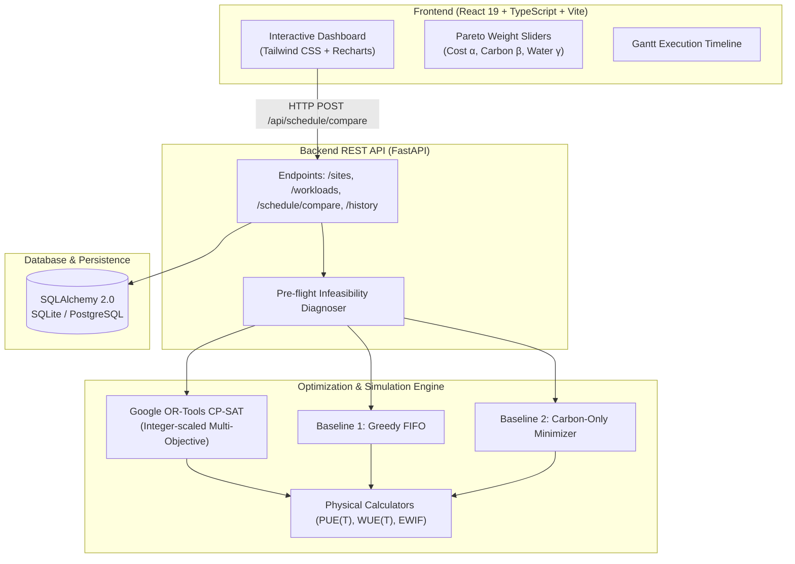

# AquaGrid: AI Workload Scheduling with Water, Energy, and Carbon Awareness 🌊⚡🌿

[](https://www.python.org/)
[](https://fastapi.tiangolo.com/)
[](https://developers.google.com/optimization)
[](https://react.dev/)
[](https://www.typescriptlang.org/)
[](https://docs.pytest.org/)
[](https://www.docker.com/)

AquaGrid is an optimization platform and decision-support simulation that coordinates flexible AI compute tasks across geo-distributed datacenters to balance **electricity costs**, **operational carbon emissions**, and **direct & indirect freshwater consumption**.

---

## The Real-World Problem: The "Green Cloud" Water Conflict

Leading cloud providers (Google, Microsoft, Meta) currently practice **carbon-aware computing**: shifting non-urgent AI batch workloads to peak solar hours (12:00 PM – 3:00 PM). 

**The Unintended Consequence:** In regions with high solar generation (e.g. Phoenix, Arizona), peak solar noon coincides with extreme desert ambient temperatures (**40°C – 42°C**). To prevent GPUs from overheating, evaporative cooling towers must evaporate thousands of liters of drinking water per hour.

**AquaGrid demonstrates that optimizing for carbon alone reduces emissions but causes severe localized freshwater spikes (violating municipal water limits).** By formulating workload placement as a **Constrained Multi-Objective Optimization Problem via Google OR-Tools (CP-SAT)**, AquaGrid mathematically guarantees hard regional water budgets while capturing the benefits of clean renewable energy.

---

## Empirical Benchmark Findings (Default Scenario)

Tested across 3 geo-distributed facilities (Phoenix, AZ; Quincy, WA; Council Bluffs, IA) and 5 canonical AI training/inference workloads:

| Scheduler Strategy | Total Carbon | Total Water | Phoenix Water Consumed | Water Budget Compliance |
| :--- | :--- | :--- | :--- | :--- |
| **1. Naive FIFO** *(Status Quo)* | $119.8\text{ kg}$ | $540.6\text{ L}$ | $354.6\text{ L}$ | 🟢 Compliant ($0\text{L}$ violation) |
| **2. Carbon-Only** *(Industry Standard)* | **$17.7\text{ kg}$** | $945.8\text{ L}$ | $462.6\text{ L}$ | 🔴 **Violates 400L Budget (+62.6L)** |
| **3. AquaGrid CP-SAT** *(Balanced)* | **$18.5\text{ kg}$** | $1,036.8\text{ L}$ | **$393.1\text{ L}$** | 🟢 **100% Compliant ($0\text{L}$ violation)** |
| **4. AquaGrid CP-SAT** *(Water-First)* | $28.6\text{ kg}$ | **$772.4\text{ L}$** | **$355.0\text{ L}$** | 🟢 **100% Compliant ($0\text{L}$ violation)** |

* **Key Takeaway:** AquaGrid captures **85.2% of the carbon savings** of the Carbon-Only baseline, while strictly respecting local water conservation budgets (0L violation). Under `WATER_FIRST` mode, water usage drops by **25.5%**.

---

## Technical Architecture



---

## Mathematical Formulation Highlights

### 1. Thermal Dynamic PUE & WUE Equations
- **Power Usage Effectiveness (PUE)**:
  $$\text{PUE}(s, t) = \text{base\_pue}_s + \eta_s \cdot \max(0, T_{\text{amb}}(s, t) - T_{\text{economizer}})$$
- **Direct Water Usage Effectiveness (WUE)**:
  $$\text{WUE}_{\text{direct}}(s, t) = \text{base\_wue}_s + \kappa_s \cdot \max(0, T_{\text{amb}}(s, t) - T_{\text{economizer}})$$
- **Electricity Consumption**:
  $$E_{\text{total}}(s, t) = E_{\text{IT}}(s, t) \times \text{PUE}(s, t)$$
- **Total Water Footprint**:
  $$\text{Water}_{\text{total}} = E_{\text{IT}} \times \text{WUE}_{\text{direct}} + E_{\text{total}} \times \text{EWIF}$$

### 2. CP-SAT Integer Scaling & Multi-Objective
Because Google OR-Tools CP-SAT performs exact discrete constraint optimization on integers:
- Cost: Scaled to **cents** ($\times 100$)
- Carbon: Scaled to **grams** ($\times 1,000$)
- Water: Scaled to **milliliters** ($\times 1,000$) and **deciliters** ($\times 10$)

**Objective Function**:
$$\min \sum_{j, s, t} x_{j, s, t} \cdot \left( \alpha \cdot \text{Cost} + \beta \cdot \text{Carbon} + \gamma \cdot \text{Water} \right)$$
Subject to:
1. $\sum_j x_{j, s, t} \cdot g_j \le C_s^{\text{GPU}} \quad \forall s, t$ *(GPU Capacity)*
2. $\sum_{j, t} x_{j, s, t} \cdot W_{\text{direct}}(j, s, t) \le \text{Budget}_s \quad \forall s$ *(Hard Water Budget)*
3. $\sum_{s, t} x_{j, s, t} = p_j \quad \forall j$ *(Job Duration Completion)*
4. Single-site execution & contiguous interval blocks for non-preemptible workloads.

---

## Quickstart

### Option A: One-Click Docker Launch (Recommended)
```bash
docker compose up --build
```
- **Web Dashboard**: `http://localhost:5173`
- **FastAPI Swagger Docs**: `http://localhost:8000/docs`

---

### Option B: Local Development

#### 1. Backend Setup (Python 3.12)
```bash
# Clone the repository
git clone https://github.com/Ruchithak71/aquagrid-ai-workload-scheduler.git
cd aquagrid-ai-workload-scheduler

# Create virtual environment
python -m venv .venv
source .venv/bin/activate   # Linux/macOS
.venv\Scripts\activate      # Windows

# Install backend dependencies
pip install -r requirements.txt

# Run full test suite (83 tests)
pytest backend/tests/ -v

# Start FastAPI server
uvicorn src.api.main:app --reload --app-dir backend
```

#### 2. Frontend Setup (React 19 + TypeScript)
```bash
cd frontend
npm install
npm run dev
```
Open **`http://localhost:5173`** to access the dashboard.

---

## REST API Reference

| Method | Endpoint | Description |
| :--- | :--- | :--- |
| `GET` | `/api/health` | Health check & service status |
| `GET` | `/api/sites` | List all 3 datacenter regions & physical specs |
| `GET` | `/api/sites/{id}/environmental` | 24-hour weather, carbon & price telemetry curves |
| `GET` | `/api/workloads` | List 5 canonical benchmark AI workloads |
| `POST`| `/api/schedule/run` | Execute individual scheduler (`fifo`, `carbon_only`, `cpsat`) |
| `POST`| `/api/schedule/compare` | Execute 6-way benchmark comparison |
| `POST`| `/api/schedule/diagnose` | Pre-flight feasibility check (GPU deficits & deadline slack) |
| `GET` | `/api/history` | List saved historical benchmark runs from database |
| `GET` | `/api/history/{id}` | Retrieve full report JSON for a historical run |
| `DELETE`| `/api/history/{id}` | Delete historical benchmark run |

---

## Automated Test Coverage

The test suite contains **83 automated unit and integration tests** across the full stack:
- `test_models.py` (10 tests): Pydantic validation, physical boundary constraints.
- `test_simulation.py` (10 tests): Dynamic PUE/WUE thermal models, carbon, cost equations.
- `test_datasets.py` (9 tests): Canonical benchmark profiles for Phoenix, Quincy, Council Bluffs.
- `test_scheduling.py` (9 tests): Greedy FIFO baseline contract & execution slices.
- `test_carbon_only.py` (6 tests): Carbon-Only minimizer & water budget violation proof.
- `test_cpsat.py` (8 tests): Hard constraints, water budget enforcement, non-preemption.
- `test_pareto.py` (6 tests): Pareto frontier sweeping across operational presets.
- `test_diagnoser.py` (5 tests): Capacity bottleneck & deadline window feasibility detection.
- `test_comparator.py` (5 tests): Multi-model comparison engine & delta percentage calculations.
- `test_api.py` (12 tests): FastAPI HTTP integration tests via TestClient.
- `test_history.py` (3 tests): Database persistence, retrieval, and deletion.

---

## License
MIT License. Built by Ruchitha K.
